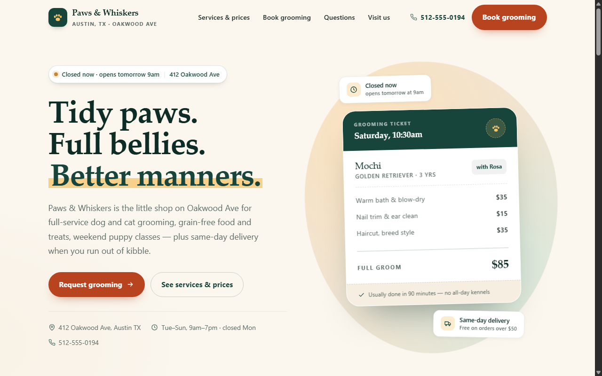

# one-shot

**Stop AI coding agents from lying about "Done!"**

A **37-line agent skill** + **zero-dependency executable verifier (`verify.mjs`)** + **tamper-proof SHA-256 `treeHash` receipt** + **native Stop-Hook** for Claude Code, Cursor, Codex, OpenCode, ZCode, and Antigravity.

Instead of letting an AI tick `[x]` in markdown and hand you broken code that takes 2–3 follow-up rounds to fix, `one-shot` binds every acceptance criterion to an executable command and **physically blocks the agent from finishing until the live app survives tests, security/IDOR/fuzz probes, and DOM checks.**

---

## Real Before vs. After Proof (Same Model, Same 5-Line Prompt)

**Prompt:** *"Build me a landing page for my local pet shop called Paws & Whiskers..."* (normal human prompt — zero color, font, layout, contrast, or testing instructions). **Model:** DeepSeek V4.1 Flash.

| **Without `one-shot` (Baseline)** | **With `one-shot` v0.3.0** |
| :---: | :---: |
|  |  |
| Claimed *"no internet needed"* while shipping **2 external `https://` URLs** | **0** external URLs — genuinely offline |
| **FAIL** WCAG AA contrast (`a.btn` **3.60:1**, `span.ticket__time` **1.00:1** invisible text) | **PASS** — **159/159** visible text nodes >= 4.5:1 |
| **1** unlabeled form input (`9` inputs) | **0** unlabeled form inputs (`9/9` labeled) |
| `88.7 KB` (`1,649 lines`), **0 tests**, **0 proof** | **`55.7 KB` (`1,422 lines` — 37% leaner)**, `tests/page.test.mjs` + `GATE-RECEIPT.json` (`15 pass, 0 fail`, `treeHash` verified) |

---

## Install (30 Seconds, Zero Dependencies)

### Option 1 — Node 20+ CLI (Recommended)

```sh
git clone https://github.com/HailLucifer666/one-shot.git && cd one-shot

# Auto-detect Claude Code, Cursor, Codex, OpenCode, ZCode, and Antigravity,
# install one-shot/ v0.3.0, byte-verify every file, and register the Claude Code Stop-Hook:
node bin/one-shot.mjs install --with-hook
```

### Option 2 — POSIX Shell Installer (No Node required to install)

```sh
git clone https://github.com/HailLucifer666/one-shot.git && cd one-shot
./install.sh                            # Claude Code (~/.claude/skills)
./install.sh ~/.config/opencode/skill   # OpenCode
./install.sh ~/.zcode/skills            # ZCode
```

---

## Usage

In Claude Code, Cursor, Codex, OpenCode, ZCode, or Antigravity:

```text
/one-shot Build a team snippet sharing API with auth and HTML preview.
```

### CLI Commands (Also Usable in CI / GitHub Actions)

```sh
# Verify all installed skill copies byte-for-byte
node bin/one-shot.mjs install --verify

# Scaffold one-shot-work/contract.json (+ baseline.json for brownfield + git pre-commit hook)
node bin/one-shot.mjs init --brownfield --git-hook

# Run the executable release-gate verifier (writes tamper-proof one-shot-work/GATE-RECEIPT.json)
node bin/one-shot.mjs verify --dir .

# Fast (<25ms) tamper/freshness check of GATE-RECEIPT.json against the live working-tree treeHash
node bin/one-shot.mjs verify --dir . --check-receipt

# Stop-Hook / pre-commit enforcer (exits 0 if no contract or fresh PASS; exits 2 if missing/stale/BLOCKED)
node bin/one-shot.mjs hook-check --dir .
```

---

## How `one-shot` v0.3.0 Works

1. **One Contract, Not Six Markdown Files (`one-shot-work/contract.json`):** Binds every acceptance criterion to an executable check command, plus deliverables, server commands, and optional brownfield `allowedFiles` / `minTestCount` guards.
2. **Adversarial Domain Packs (Loaded Only When Needed):**
   - `modules/app.md` — IDOR ownership probes, auth bypass, malformed JSON, XSS, SSRF, secrets.
   - `modules/web.md` — 360/768/1280px overflow, computed WCAG AA contrast, zero dead controls, console errors.
   - `modules/brownfield.md` — diff-scope whitelist guard, watched-red regression test rule, preserve existing suite.
   - `modules/stack.md` — live registry version lookup + major-version breaking-change check (no stale hardcoded versions).
3. **Reactive Rigor:** Starts fast (watched-red acceptance tests → minimal code) and escalates to `<=150`-line micro-slices + `DIAGNOSIS.md` **only** after 2 consecutive failures on the same criterion.
4. **Tamper-Proof Gate + Stop-Hook (`verify.mjs` → `GATE-RECEIPT.json`):**
   - Runs project tests, build, contract criteria, diff-scope & non-commented test-count floor.
   - Boots live servers on a random port and probes health, malformed JSON (no 500/stack trace), `401`/`403` auth guard, XSS/SQLi/prototype-pollution fuzzing, and multi-user IDOR.
   - Scans `.env`/`.gitignore`, secret literals (string-aware), visible HTML placeholders, and runs Playwright DOM checks (console errors, 360/768/1280px overflow, WCAG AA contrast, dead controls, broken/alt-less images).
   - Signs `GATE-RECEIPT.json` with a composite SHA-256 `treeHash` of the project tree. Any post-gate edit invalidates `treeHash` and causes `hook-check` to block completion until re-verified.

---

## Honest Benchmarks (No Cherry-Picking)

We publish ties alongside wins so you know exactly where `one-shot` helps and where it doesn't:

| Benchmark | Model(s) | Result | What It Showed |
|---|---|---|---|
| **Vague Everyday Prompt** (*Paws & Whiskers* landing page, v0.3.0) | DeepSeek V4.1 Flash | **Skill wins** (`0` defects vs `3` defects + offline lie) | Baseline shipped `1.00:1` invisible text, `3.60:1` buttons, unlabeled input, and 2 external URLs; `one-shot` passed 159/159 contrast checks at 37% smaller size with verified `treeHash`. |
| **Hard-Mode Security Traps (`H4`)** ([`benchmark-hard/RESULTS.md`](benchmark-hard/RESULTS.md)) | GLM 5.3 Flash | **Skill wins (+16.6 pts)** (`17/18` vs `14/18`) | Baselines passed happy-path tests while shipping IDOR/auth/SSRF gaps; `one-shot` caught them. |
| **Explicit 10-Bullet Specs** (5 builds × 3 models, v0.3.0) | DeepSeek V4.1, Hy4, GLM 5.3 | **5/5 vs 5/5 functional tie** | When the user prompt already spells out every edge case, strong models pass both arms; `one-shot` still enforced 5/5 untampered `treeHash` receipts, 44% leaner HTML on Build 01, and strict token allowlist + body cap on Build 02. |
| **Original v0.1 / v0.1.4 Ceiling Battery** (`benchmark/runs/`) | GLM 5.3 Flash (ZCode) | **10/10 vs 10/10 tie** | Proved that v0.1's 6-file markdown ceremony added 1.5–5.1× token overhead on easy specs — which directly motivated v0.2/v0.3's slim 37-line kernel + executable gate. |

---

## Repo Layout

- `one-shot/`: the v0.3.0 skill (`SKILL.md` — 37 lines, `gate.md`, `intake.md`, `modules/{app,web,brownfield,stack}.md`, `templates/contract.json`, `scripts/verify.mjs` + `test_verify.mjs`)
- `bin/`: zero-dep Node 20+ CLI (`one-shot.mjs` + `test_cli.mjs`)
- `package.json`: zero-dependency package manifest (`engines.node >= 20`)
- `scripts/`: `validate_skill.py`, `audit_history.py`, and their unit/e2e test suites
- `benchmark/`, `benchmark-hard/`, `benchmark-v3/`: specs, frozen starters, scoring scripts, and vendored historical records
- `docs/assets/`: before/after benchmark screenshots

---

## Limitations

- A skill + verifier reduces risk; it does not prove software is bug-free or formally secure.
- `GATE-RECEIPT.json` proves only the checks that executed (skipped checks such as Playwright when not installed are recorded honestly as `SKIPPED`).
- On tiny, hyper-specified tasks with frontier models, a baseline will often tie on pass rate; the real payoff is on realistic vague prompts, multi-file/brownfield edits, security traps, and cheaper/local models.

## License

MIT
